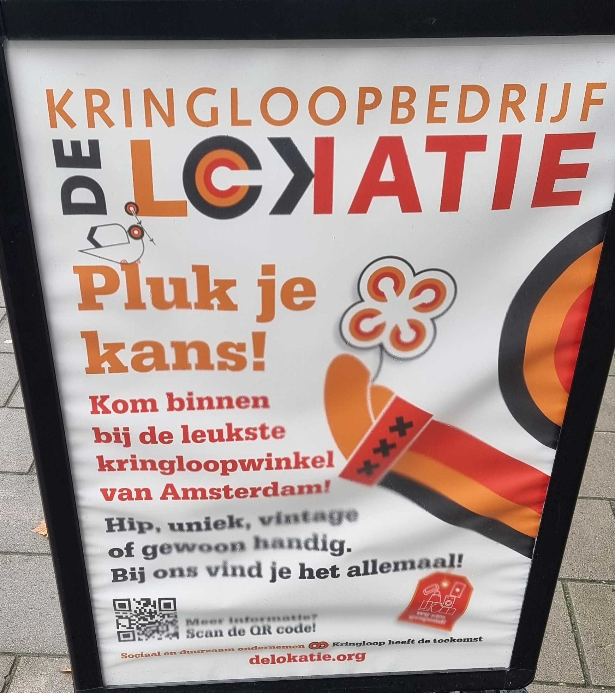
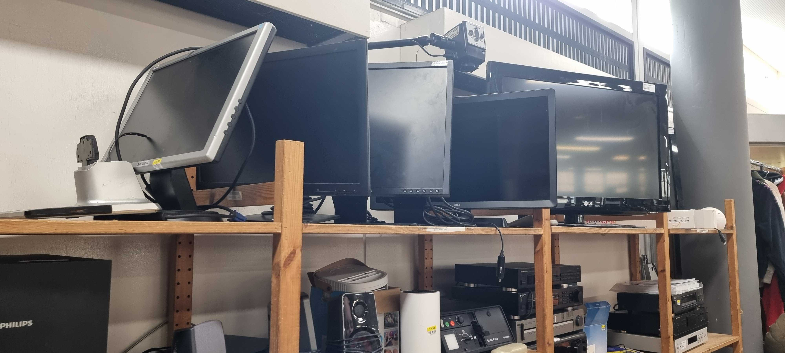
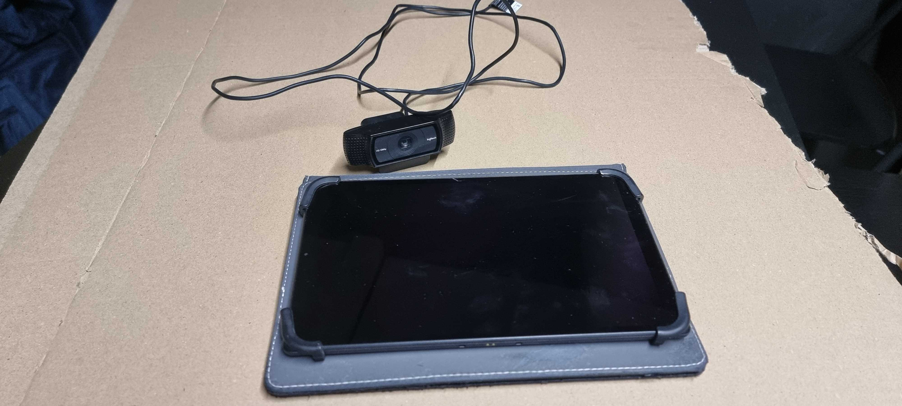
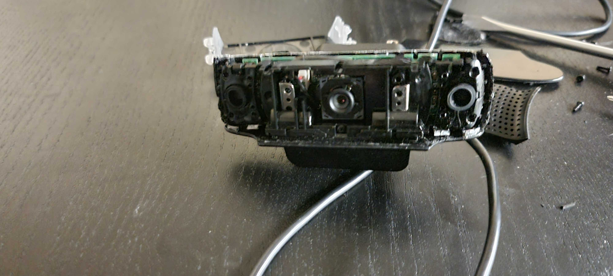
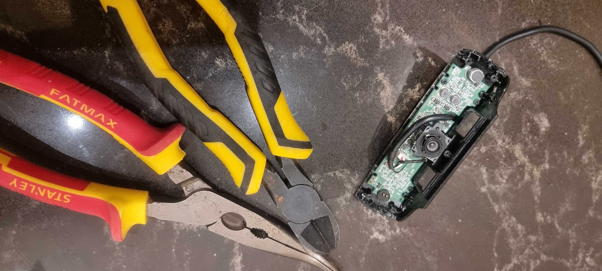
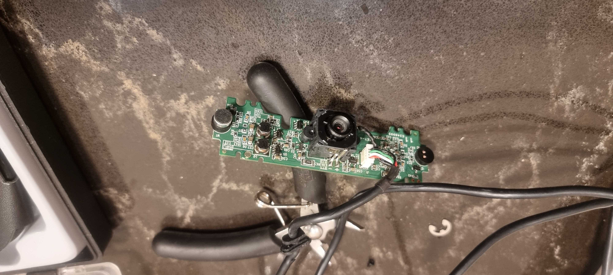
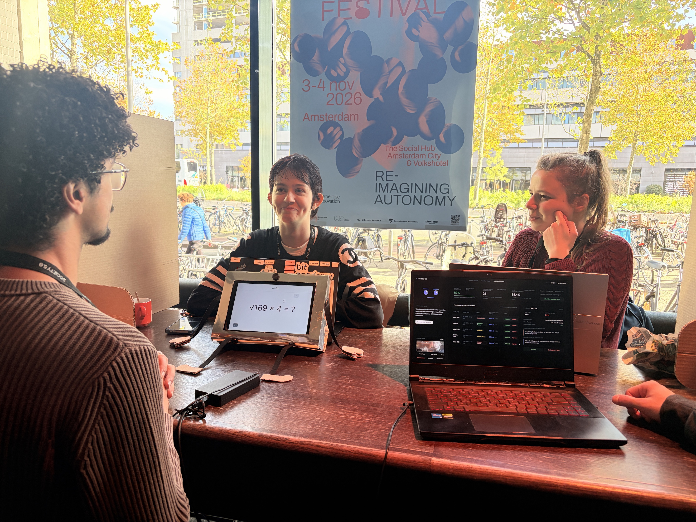

<nav>
  <a href="{{ site.baseurl }}/index.html">Sprint 1</a> | 
  <a href="{{ site.baseurl }}/sprint2.html">Sprint 2</a>
</nav>
  

# Sprint 2
_05/11/2026_

Deze sprint lag mijn focus vooral op het design, het vinden van de apparaten die wij nodig hebben voor dit project en de voorbereiding op Society 5.0. 

## Stap 1: Het vinden van een tablet/beeldscherm

  
  

 

Voor onze robot ben ik eerst op zoek gegaan naar beeldschermen. Omdat wij maar een klein budget hebben voor het project, wilde ik eerst kijken of ik het beeldscherm gratis kon krijgen. De beeldschermen die ik gratis aangeboden kreeg, waren alleen te groot. Eén beeldscherm had het juiste formaat (10.1 inch), maar zat nog vast aan een grote machine waarop allemaal waarschuwingen stonden dat je het er niet zomaar af kan halen. Daarom stelde ik aan mijn team voor dat wij het best bij kringloopwinkels konden kijken; ik hoopte daar voor weinig geld een beeldscherm of tablet op de kop te tikken.
 

  
  

 

Ik ben bij verschillende kringloopwinkels geweest, maar zij hadden geen tablets en ook geen kleine beeldschermen. Daarna had ik ook bij de uitleenservice van de HvA gekeken, maar die tablets kun je maar voor een week lenen. Gelukkig had ik een paar dagen daarvoor, samen met mijn vader, een bericht gezet in een Facebookgroep genaamd 'De weggeefhoek (+stadsnaam)'. Daarin hadden wij gevraagd of iemand misschien een oude 10.1 inch tablet had die niet meer gebruikt werd. Dat verliep eerst een beetje stroef, maar soms reageerden er wel mensen. Mijn vader en ik kregen vaak de reactie dat er instanties zijn die hierbij kunnen helpen, maar ik had de tablet voor iets totaal anders nodig dan waar deze instanties mee kunnen of willen helpen. Uiteindelijk hebben wij toch een tablet voor niks bij iemand kunnen ophalen.

## Stap 2: Aan de slag met de apparatuur

 

Voor ons project willen wij dus een tablet gebruiken, maar het liefst ook een camera. Thuis had ik nog een oude webcam liggen waarvan het snoertje waarschijnlijk stuk is. Als de rest van de onderdelen nog werkt, dan kunnen wij die gebruiken en dan besparen wij weer op het budget.
 

 

Op school heb ik alle schroefjes die ik kon vinden uit de webcam gehaald en er ook stukken plastic van verwijderd. Ik ben uiteindelijk gestopt omdat ik bang was dat ik de onderdelen zou beschadigen, en omdat het juiste gereedschap niet op school te vinden was. 
 

  
  

 

Uiteindelijk heb ik thuis met tangen stukken plastic eraf weten te krijgen en de laatste schroefjes uit de webcam gehaald. Alle onderdelen waarvan ik dacht dat ze misschien handig zouden zijn, zoals de microfoon, heb ik ook bewaard.

## Stap 3: Een nieuw paper prototype maken
Wij wilden graag ons paper prototype van de vorige sprint gebruiken voor onze tests bij Society 5.0. Helaas was het prototype weggegooid door een docent, dus heb ik een nieuwe gemaakt.

 

Deze keer wilde ik graag een design maken waar de tablet in past, zodat de testpersonen bij Society 5.0 niet alleen een tablet hadden om de test op te doen, maar ook een beeld kregen van hoe Juf Aimee er uiteindelijk uit komt te zien. 
Ik heb dit gedaan door op karton de omtrek te tekenen van de tablet in de hoes. Zo past het er met hoes en al in en hoopte ik dat het er ook goed in zou blijven zitten. Daarbuiten heb ik alle onderdelen die eromheen komen te zitten ook meteen op het karton getekend. Het was best lastig om de juiste maten te vinden en ik heb het vaak moeten aanpassen, maar uiteindelijk is het gelukt en heb ik het uitgesneden.
 

 

Het uitsnijden ging helaas niet helemaal goed. De tekening klopte toch niet helemaal, waardoor ik te veel van het karton had weggesneden. Vervolgens had ik alles aan elkaar geplakt met lijm. Alleen één hoek zag er niet helemaal mooi uit, maar dat is later alsnog opgelost.

  
  

 

Bij deze stap heb ik het stuk karton uitgesneden waar de tablet komt te zitten. Serena heeft mij geholpen met het afwerken van het prototype. Zo hadden wij de metaallook van één van onze vorige prototypes, waarvan medestudenten zeiden dat ze het mooi vonden, ook aan dit prototype toegevoegd. Dit hielp meteen bij het verbergen van kleine foutjes.

 

Dit is het uiteindelijke prototype geworden dat wij bij Society 5.0 hebben gebruikt. Door het maken van dit prototype weet ik wel wat ik voor de volgende keer anders moet doen: er is meer ruimte nodig voor de oplaadkabel en waarschijnlijk ook voor de camera, dus het volgende prototype wordt iets groter. Een ander probleem was dat de tablet steeds om bleef vallen. Daarom heb ik aan mijn teamgenoten gevraagd of zij misschien oude kranten hadden om achter de tablet te stoppen. Zo hebben wij het uiteindelijk ook opgelost.

## Stap 4: Het maken van het scherm op de robot

 
Tijdens de vorige sprint hadden wij er eigenlijk niet over nagedacht hoe de opdrachten voor de hoogbegaafde leerlingen er uiteindelijk uit zouden zien. Daarom ben ik daar deze sprint mee begonnen. Op dit design wordt uitgelegd wat de opdracht precies inhoudt, waarna de leerlingen keersommen kunnen maken. Na het maken van de sommen kunnen zij zien hoe hoog zij op het scorebord staan van alle leerlingen. Eerst had ik een tekening gemaakt om te kijken of mijn ideeën ook echt werkten en vervolgens heb ik dit uitgewerkt in een Figma-design.

  <iframe width="560" height="315" src="https://www.youtube.com/embed/K1oRKt3Fhi0" title="YouTube video player" frameborder="0" allow="accelerometer; autoplay; clipboard-write; encrypted-media; gyroscope; picture-in-picture" allowfullscreen></iframe>

Bij Society 5.0 konden de testpersonen het dashboard testen dat we voor de docent hebben ontworpen, maar ik wilde heel graag dat zij de 'robot', die de leerling uiteindelijk gaat gebruiken, ook konden uitproberen. Daarom had ik het Figma-design voor het evenement aangepast. Het originele design werkte niet omdat de leerling eigenlijk met Juf Aimee moet praten en wij nog geen microfoon hebben. Daarbij kan dat ook niet in een Figma-design verwerkt worden. Ik heb dit opgelost door groene en rode knopjes aan de schermen toe te voegen, waar wij op konden drukken als de testpersonen de sommen goed of fout hadden. Op het eindscherm konden zij dan zien waar ze op het scorebord belandden.

## Stap 5: Testen bij Society 5.0
Mijn idee voor de test was dat één van ons Juf Aimee's stem zou zijn en opmerkingen zou maken, iemand anders hardop aantekeningen zou maken van wat de testpersoon deed, en weer iemand anders op de knopjes op de tablet zou drukken.

 

Tijdens de tests heb ik alle drie de rollen uitgevoerd, maar ik heb mij vooral gericht op het maken van aantekeningen. Voor mijn gevoel hebben we veel aan deze tests gehad. Veel van de testpersonen gaven mij het idee dat het echt een dark prototype was; ze zagen er vaak nerveus uit en hadden echt moeite met de interactie met Juf Aimee. Hierdoor heb ik ontzettend veel over ons project geleerd en weet ik nu precies wat er de volgende sprint aan veranderd moet worden. 

## Eindresultaat & wat ik heb geleerd
Door het maken van het nieuwe paper prototype weet ik nu wat er aan de volgende versie moet veranderen. Deze sprint heb ik wederom geleerd dat prototypes nooit meteen perfect zijn en het maken ervan niet altijd vlekkeloos verloopt. Het klinkt logisch, maar ik heb deze sprint ook gemerkt hoe belangrijk het is om uitgebreid te testen. Hoewel ik mijn prototypes altijd laat testen, gebeurt dat op kleinere schaal dan bij Society 5.0. Er is altijd ruimte voor verbetering, en testpersonen komen soms met heel waardevolle inzichten.
 

## De volgende sprint
De volgende stappen voor sprint 3:
- Behuizing voor de robot ontwerpen en maken.
- Gamification integreren bij het design voor het scherm op de tablet.
- De feedback van de opdrachtgever, medestudenten en andere testpersonen verwerken in de nieuwe prototypes.
- Bepalen of wij willen dat Juf Aimee heel onaardig is of juist heel aardig.
- Camera werkend krijgen (en een nieuw onderdeel bestellen als de huidige niet werkt). 
- Een microfoon en speakers of koptelefoon regelen.
- Andere testpersonen zoeken die vergelijkbaar zijn met hoogbegaafden (zoals neurodivergenten of thuiszitters).
- Zorgen dat de testpersonen echt kunnen praten met Juf Aimee.

## Feedback
Ik heb mijn devlog tijdens de werkgroep niet kunnen bespreken met medestudenten omdat ik ziek was. Daarom heb ik op een andere dag alsnog feedback gevraagd aan studenten uit mijn werkgroep. Heel veel dingen gingen deze sprint goed:
- Ik heb het niet kunnen vinden van een tablet op een goede manier opgelost.
- Ik heb goed geëxperimenteerd met de prototypes, waardoor ik fouten kon oplossen.
- Er is tijdens en na het testen goed nagedacht over de manier waarop we Juf Aimee willen maken.
- Het was erg goed dat het weggooien van het paper prototype mij niet heeft tegengehouden en dat ik een nieuwe heb gemaakt. Dit laat zien dat ik het geduld heb om bij fouten of onverwachte omstandigheden opnieuw te beginnen.
Een aantal dingen die nog moeten verbeteren of aangepast kunnen worden:
- Op tijd aankloppen bij een docent als er iets niet goed gaat binnen mijn projectgroep.
- Het idee om de testgroep uit te breiden is goed, maar deze testpersonen moeten van buiten school komen.

Ik heb veel aan deze feedback gehad, ook omdat er erg belangrijke punten bijzitten om te verbeteren. Ik ga dit zeker meenemen in de volgende sprint.
