<nav>
  <a href="{{ site.baseurl }}/index.html">Sprint 1</a> | 
  <a href="{{ site.baseurl }}/sprint2.html">Sprint 2</a> |
  <a href="{{ site.baseurl }}/sprint3.html">Sprint 3</a> |
  <a href="{{ site.baseurl }}/sprint4.html">Sprint 4</a> |
  <a href="{{ site.baseurl }}/floor.html">FLOOR</a> |
</nav>
  

# Sprint 3
_25/11/2026_

Deze sprint lag mijn focus wederom vooral bij het design en het regelen van apparaten, onderdelen en overige materialen die wij nodig hebben voor ons project.

## Stap 1: FLOOR

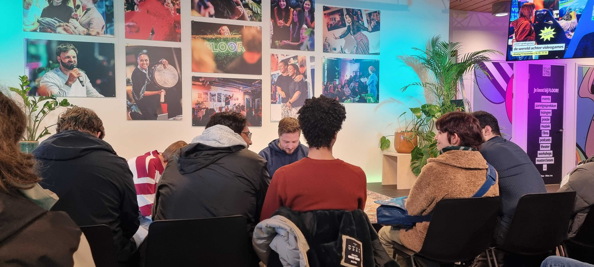
 

Bij FLOOR geven wij de uiteindelijke presentatie van ons provocotype. Samen met Serena ging ik ernaartoe om onze benodigdheden door te geven. 
 Hier heb ik om gevraagd:
- Een hoge tafel.
- Twee stopcontacten.
- Een plek waar weinig mensen lopen, aangezien ons project facial recognition gebruikt.
- Een plek niet te dicht bij Shadow Harry, want dat provocotype is vergelijkbaar met dat van ons.

Dit heb ik aangegeven:  
- Wij hebben een microfoon.  
- Wij hebben een koptelefoon.  
 

Dit is belangrijk voor de medewerkers van FLOOR om te weten, zodat zij kunnen bepalen waar elk project het best kan staan. Aan de hand van de wensen van alle teams, wordt er een plattegrond gemaakt.

Het was heel erg leerzaam om hiernaartoe te gaan. Het werd duidelijker wat wel en niet mogelijk is voor ons project en wat wij nog moeten regelen. Toen ik namelijk iemand naast de hoge tafels zag staan, werd het mij meteen helder dat Juf Aimee voor sommigen veel te laag zal staan. Mijn idee is om het op een kleine kinderstoel, een stapel boeken of een zelfgebouwde houten verhoging te zetten. In ieder geval kunnen wij ons nu beter voorbereiden.

## Stap 2: Hoe krijgen we het dashboard werkend op de tablet?

Mijn team wilde graag dat het dashboard op de tablet draait en dat de microfoon, camera en koptelefoon daar allemaal aan verbonden worden. Ik heb met hen besproken dat dit mij niet verstandig leek; de tablet is al vier jaar oud en wij hebben laptops die dit veel beter kunnen verwerken. Daarbij kan de koptelefoon niet aangesloten worden op de tablet, omdat dat voor problemen zorgt met de behuizing. Tenslotte hebben wij al genoeg te doen en leek het mij veel te veel werk voor onze enige embedded student.
Voordat ik dit met hen besprak, had ik een manier gevonden om de tablet als extra scherm te gebruiken. Het is een Lenovo tablet en via Lenovo is er een app die Smart Connect heet. Met deze app kun je de tablet verbinden met een laptop en die dan als tweede scherm gebruiken. Nadat ik de problemen had aangegeven en deze app met mijn team had besproken, waren zij het ermee eens dat dit een goede oplossing zou zijn.
Na de bespreking wilde ik de app thuis even uitproberen om te kijken of het ook echt werkt.

 

  
  

 

Ik kon niet vinden hoe ik de tablet als tweede scherm kon gebruiken, zowel in het computerprogramma als in de app op de tablet. Online stond er dat er een knop moest zijn om de schermen te delen. Die optie verscheen bij mij niet. Na iets verder zoeken bleek dat de tablet hier te oud voor is. Dit was wel jammer, want dit zou een goede oplossing zijn geweest. 

 
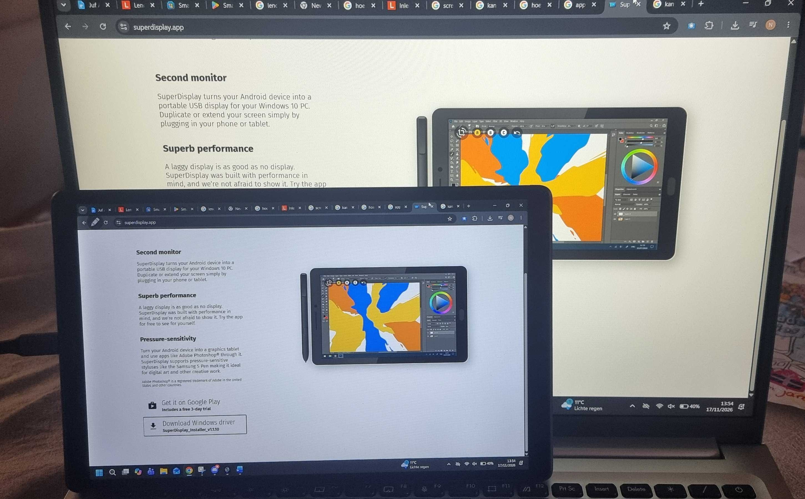
 

Later bedacht ik mij ineens dat ik een tijd geleden SuperDisplay had gekocht om mijn Samsung tablet te kunnen gebruiken als tekentablet. Dit werkt gelukkig heel goed! Wij kunnen de tablet nu aansluiten op een laptop en die wordt dan uit zichzelf meteen een tweede scherm.

## Stap 3: Apparaten regelen
Er waren nog een aantal onderdelen/apparaten die voor het project geregeld moest worden, namelijk:
- Een kabel voor de tablet.
- Een koptelefoon.
- Een microfoon.
- Een nieuwe camera.

Ik had met mijn team besproken dat er een koptelefoon en een andere kabel voor de tablet nodig zijn: niet een rechte kabel, maar één met een hoek erin. Een rechte kabel past namelijk niet in de behuizing. Vervolgens heeft Amir beide besteld.
 
Er moesten ook nieuwe cameraonderdelen besteld worden, want het onderdeel dat uit de oude webcam kwam was helaas stuk. Ik had om advies gevraagd bij embedded studenten, zodat ik wist welke ik het best kon bestellen. Toen ze binnen waren, heb ik ze aan Serena gegeven; zij is er nu mee bezig om de nieuwe camera aan de praat te krijgen.

 

  
  

 

De microfoon was zo geregeld, gelukkig had ik nog een oude Blue Snowball op zolder liggen. Wel zei mijn vader dat hij ook nog een andere microfoon had: een NEAT Skyline.

 

  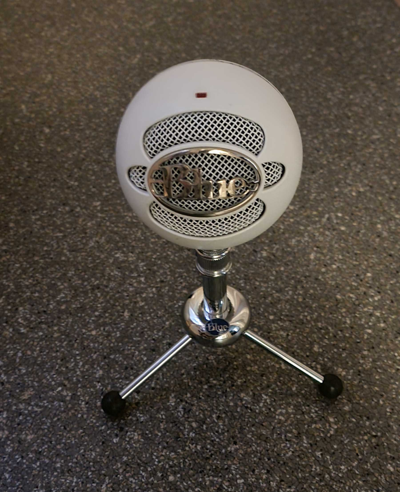
  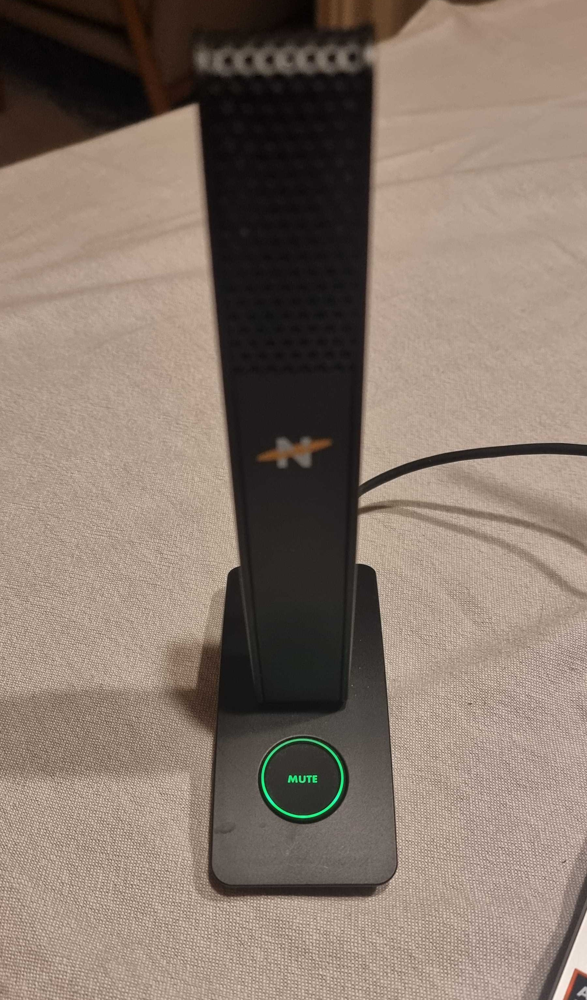

 

Ik heb online opgezocht welke van de twee beter is. Daaruit bleek dat de kwaliteit vergelijkbaar is. Uiteindelijk koos ik voor de NEAT Skyline, omdat die compacter is en ook een muteknop heeft. Eigenlijk moest mijn teamgenoot een muteknop maken voor op de tablet, maar dat was hierdoor ook niet meer nodig.

## Stap 4: Het design op een schaal van 1:1 tekenen

Ik wilde het design graag op een schaal van 1:1 tekenen. Toen ik de UX-les volgde, moesten wij een ontwerp tekenen op A3-papier, dus ik wist dat het papier in het lokaal lag. Daarom had ik de volgende dag aan een docent gevraagd of ik het mocht gebruiken; gelukkig mocht dat.

### Voorkant
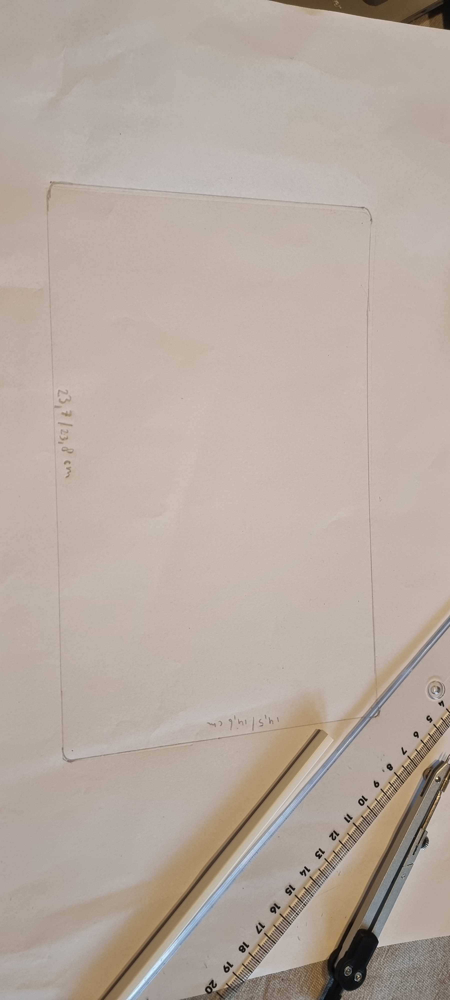
 

Allereerst had ik de tablet opgemeten, zodat ik wist hoeveel ruimte op het papier daarvoor nodig was. 

 
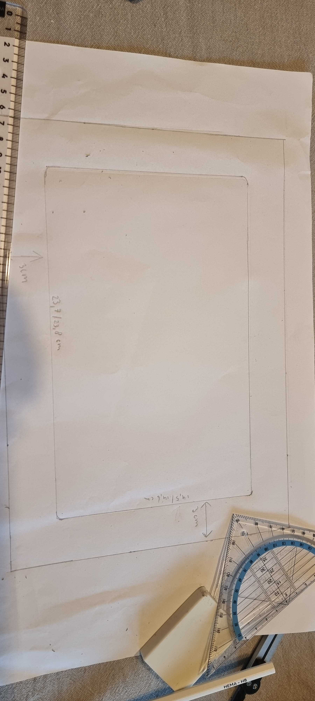
 

Vervolgens voegde ik rondom een rand van 3 centimeter toe.

 
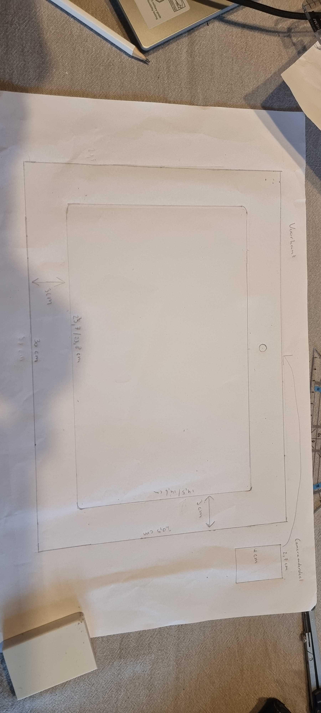
 

Tenslotte voegde ik alle maten toe en maakte ik een simpele tekening van hoe groot het cameraonderdeel is en waar het precies in het ontwerp moet komen.

### Achterkant
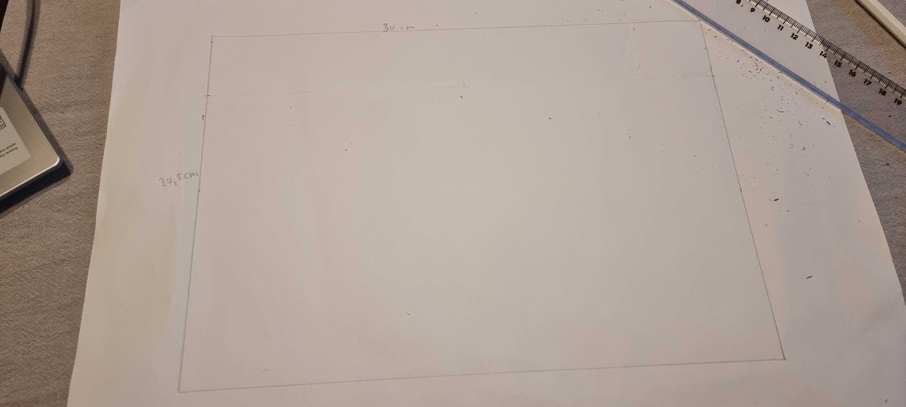
 

Voor de achterkant nam ik dezelfde maten als voor de voorkant.

 
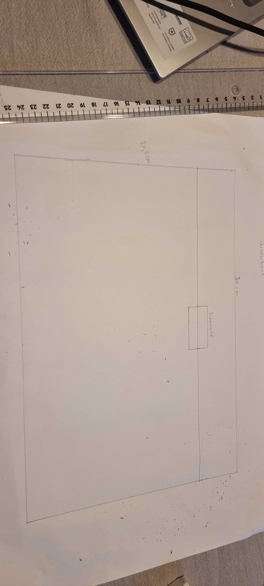
 

Ik had hier een scharnier toegevoegd, zodat wij het aan de achterkant kunnen openen.

 
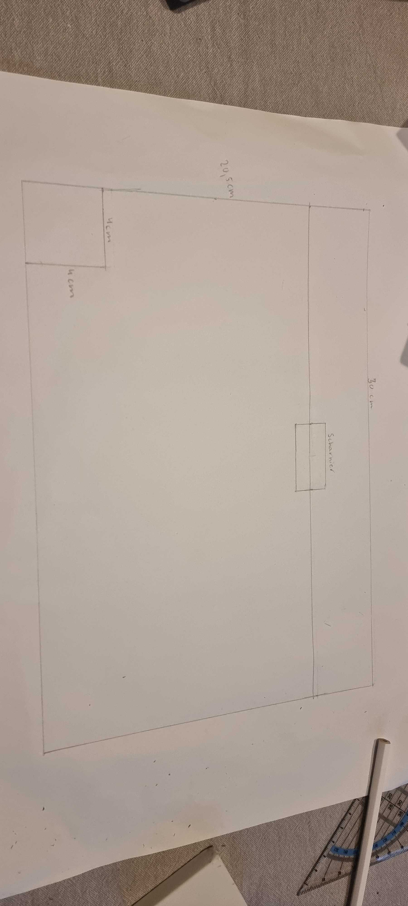
 

In de linkeronderhoek had ik een stukje weggelaten voor de kabels.

### Zijkanten
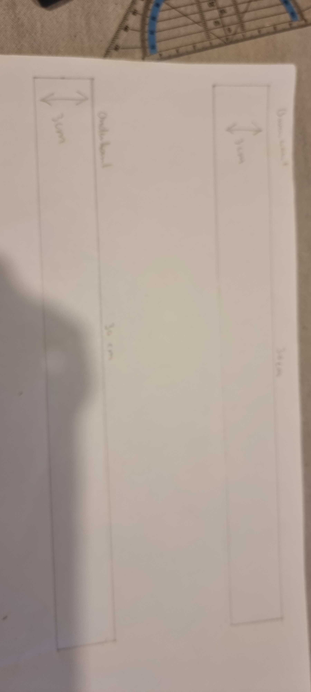
 

Voor de bovenkant, onderkant en zijkanten had ik ook voor een diepte van 3 centimeter gekozen.

 
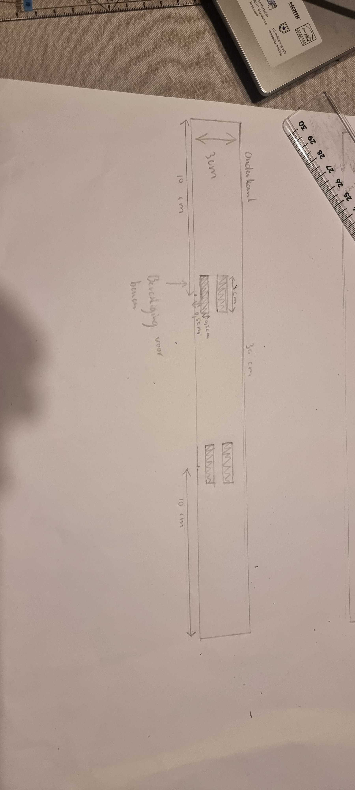
 

Mijn idee om de benen en armen te bevestigen is om voor alle vier twee gleuven in de onderkant en zijkanten te maken. Ik trek ze naar binnen door de voorste gleuven en haal ze er dan weer door de achterste gleuven heen. Vervolgens bevestig ik de ledematen aan de behuizing door het garen aan elkaar vast te knopen (verderop in de devlog leg ik uit hoe ik ze ga maken). Dat had ik hier getekend met alle maten erbij.

 
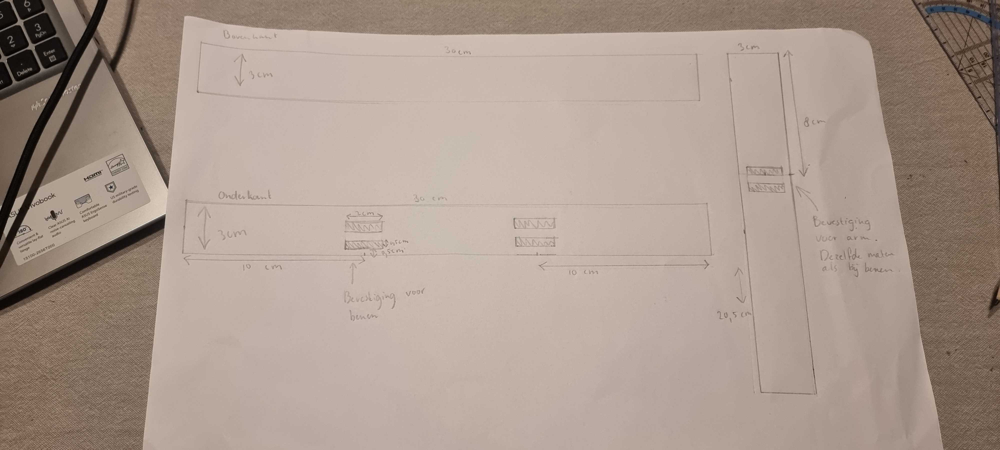
 

Vervolgens tekende ik op dezelfde manier de zijkanten van Juf Aimee.

### Veranderingen
Door het op een schaal van 1:1 te tekenen, werd het voor mij duidelijker dat dit design nog niet af is. Er zijn een aantal punten die ik nog zou aanpassen:
- Er moet meer ruimte komen in de behuizing voor de onderdelen; de camera en de tablet zitten nu te dicht op elkaar en de randen om de tablet heen zijn te dun.
- De zijkanten en de boven- en onderkant moeten dieper, ook om meer ruimte te creëren maar ook om het provocotype stabieler te maken. Deze worden waarschijnlijk in plaats van 3 centimeter, 6 centimeter.
- Aan de achterkant moeten meer scharnieren komen en iets om de achterkant vast te zetten zodat het niet elke keer opengaat.
- Op het scherm van de tablet zitten zwarte randen: 0,5 centimeter aan de boven- en onderkant en 1 centimeter aan de zijkanten. Deze kunnen worden verborgen, waardoor ik de klemmen van de tablethoes misschien ook kan gebruiken om de tablet in de behuizing vast te zetten. Die kun je dan namelijk niet meer zien.

 
(Voorbeeld van de klemmen)
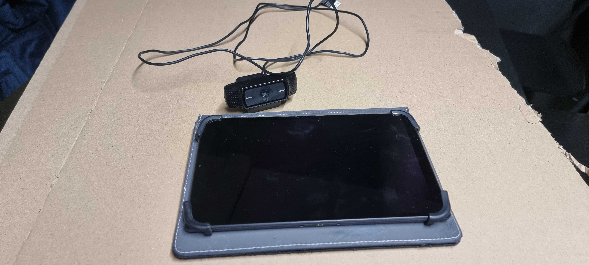
  

Ik had mijn tekeningen meegenomen naar school en besproken met mijn team. Zij waren het eens met de veranderingen. Ook vertelde Serena mij dat het cameraonderdeel niet op zijn kant kan, alleen rechtop. Daarnaast had ik gevraagd naar de lens; daar moet waarschijnlijk een gat van 1 centimeter voor komen. Er moet dus nog genoeg ruimte gemaakt worden voor de camera, waardoor de bovenste rand sowieso groter wordt dan op mijn tekening.

 
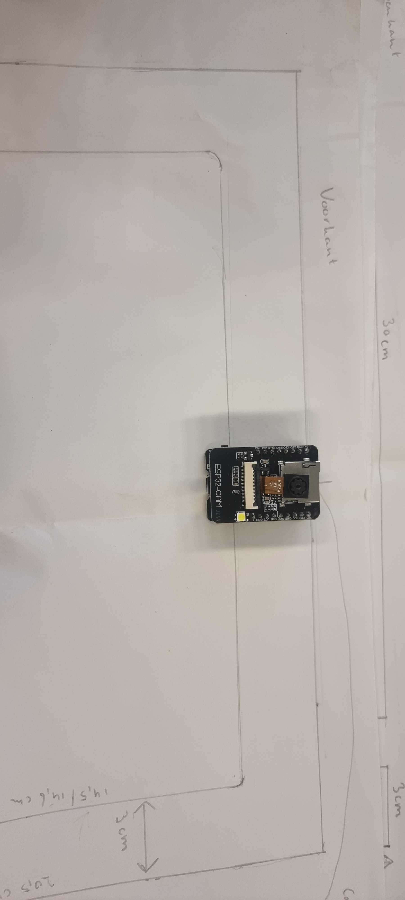
 

## Stap 5: Materialen
Ik wilde deze sprint graag beginnen met het bouwen van de behuizing. Dat kon helaas niet, omdat ik moest weten of de camera zou passen, en dat deed het dus niet. Ook lijkt het mij verstandig om eerst weer nieuwe tekeningen te maken in plaats van direct met de behuizing te beginnen.
Omdat ik niet verder kon, had ik alvast opgezocht welke materialen ik de volgende sprint nodig heb. 

### Verf
Mijn team en ik wilden dat het provocotype een chroomlook zou krijgen. Ik heb mijn best gedaan om verf te vinden die ik hiervoor kan gebruiken en die dan ook nog betaalbaar is. Hieruit bleek dat chroomverf in de meeste gevallen niet veegvast is, en anders onbetaalbaar. Daarbij kan er geen lak bovenop gespoten worden om het wel veegvast te maken. Dan verliest de verf zijn glans en wordt het dof grijs. Het provocotype wordt wel aangeraakt. Het is daarom belangrijk dat de verf goed blijft zitten. Het beste alternatief dat ik kon vinden, was metallic zilver. Dit had ik aan mijn team verteld en zij vonden dat ook een goed alternatief.

### Garen
Ik ga de armen, benen, wanten en schoenen van Juf Aimee haken. 

 

  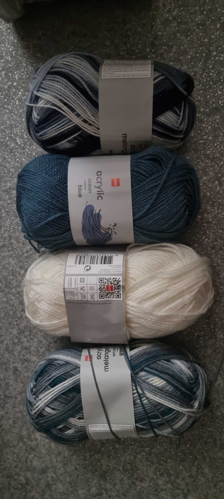
  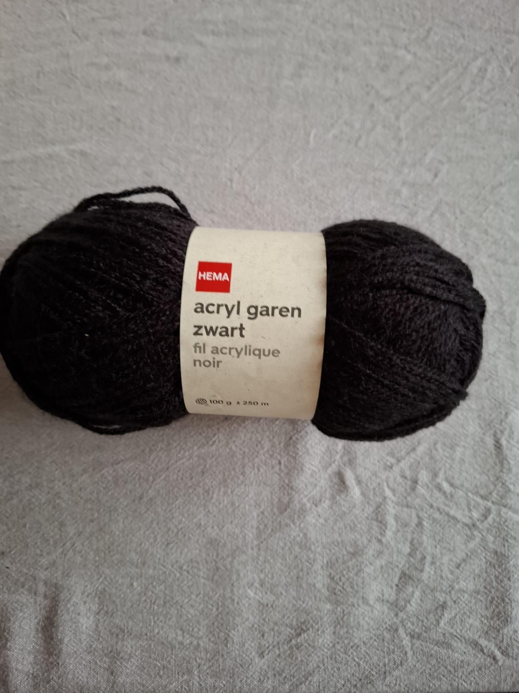

 

Van de eerste afbeelding ga ik het bovenste bolletje garen gebruiken om de wanten te haken en het blauwe daaronder voor de schoenen. Het zwarte bolletje gebruik ik vervolgens voor de armen en benen.

### Haakpatronen
Als laatste had ik haakpatronen opgezocht die ik kan gebruiken voor Juf Aimee. Hiervoor heb ik gezocht naar patronen voor babywanten en babyschoenen.

 

  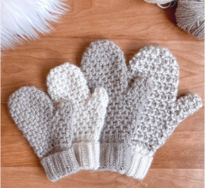
  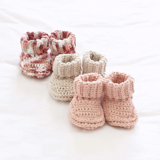

 

Dit worden waarschijnlijk de twee haakpatronen die ik ga gebruiken, vooral omdat ze zo goed bij elkaar passen.

## Eindresultaat & wat ik heb geleerd
Door het design op een schaal van 1:1 te tekenen, weet ik nu wat er moet veranderen. Hoe ik het prototype voor mij zag, is eigenlijk niet groot genoeg. Bepaalde dingen testen en uitproberen is belangrijk. Daarbij heb ik ook geleerd dat ik niet alles alleen hoef te doen, maar dat ik hierdoor ook meer tijd moet plannen voor bepaalde onderdelen van het project. Als anderen meer oppakken, is er ook de kans dat je moet wachten voordat je zelf verder kunt met jouw deel van het project. Naar mijn idee heb ik zo de volgende sprint wel al goed voorbereid.

## De volgende sprint
Dit zijn de volgende stappen voor mij bij sprint 4:
- Een nieuwe tekening maken.
- De uiteindelijke behuizing bouwen.
- Alle onderdelen en apparaten vastzetten in de behuizing.
- De ledematen van Juf Aimee haken.
- De verf kopen en op de behuizing spuiten.  

De volgende stappen voor mijn team:
- Echt met Juf Aimee kunnen praten.
- Het scherm ontwerpen dat op de tablet komt.
- Het dashboard verder afmaken.
- De camera werkend krijgen.
- Iets regelen waar Juf Aimee bovenop gezet kan worden.

## Feedback
