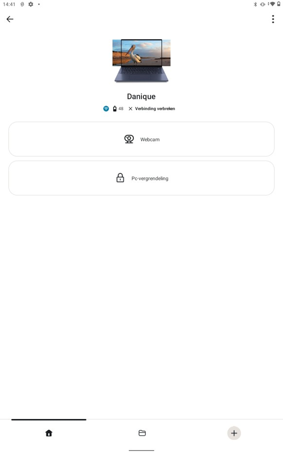
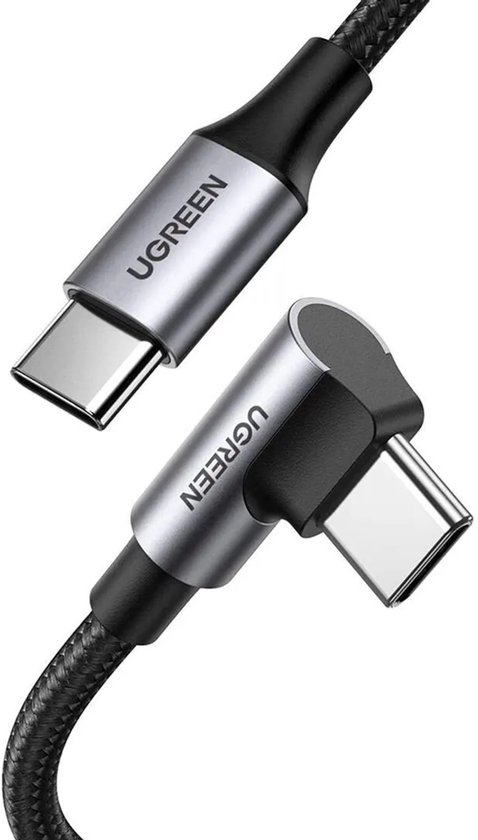
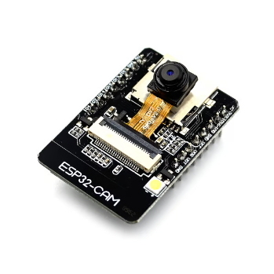

<nav>
  <a href="{{ site.baseurl }}/index.html">Sprint 1</a> | 
  <a href="{{ site.baseurl }}/sprint2.html">Sprint 2</a> |
  <a href="{{ site.baseurl }}/sprint3.html">Sprint 3</a> |
  <a href="{{ site.baseurl }}/sprint4.html">Sprint 4</a> |
  <a href="{{ site.baseurl }}/floor.html">FLOOR</a> |
</nav>
  

# Sprint 3
_25/11/2026_

Deze sprint lag mijn focus wederom vooral bij het design en het regelen van apparaten, onderdelen en bouwmateriaal wat wij nodig hebben voor ons project.

## Stap 1: FLOOR

 

Bij FLOOR geven wij de uiteindelijke presentatie van ons provocotype. Samen met Serena ging ik er naartoe om aan te kunnen geven wat wij nodig hebben voor ons project. 
 Hier heb ik om gevraagd:
- Een hoge tafel.
- Twee stopcontacten.
- Graag een plek waar weinig mensen lopen, aangezien ons project facial recognition gebruikt.
- Graag niet te dichtbij Shadow Harry, want dat provocotype is vergelijkbaar met dat van ons.
  Dit heb ik aangegeven:
- Wij hebben een microfoon.
- Wij hebben een koptelefoon.

Dit is belangrijk voor de medewerkers van FLOOR om te weten, zodat zij weten waar elk project het best kan staan. Naderhand van de wensen voor elk project, wordt er een plattegrond gemaakt.

Het was heel erg leerzaam om hier naartoe te gaan. Het werd duidelijker wat wel en niet mogelijk is voor ons project en wat wij nog moeten regelen. Toen ik namelijk iemand naast de hoge tafels zag staan, werd het mij wel duidelijk dat Juf Aimee voor sommigen veel te laag zal staan. Mijn idee is om Juf Aimee op een kleine kinderstoel te zetten, een stapel boeken of dat wij er iets voor bouwen met hout waar het op kan zitten. In ieder geval kunnen wij ons nu beter voorbereiden.

## Stap 2: Hoe krijgen we het dashboard werkend op de tablet?

Mijn team wilde graag dat het dashboard op de tablet draait en dat de microfoon, camera en koptelefoon daar allemaal aan verbonden worden. Ik heb met hun besproken dat dit mij niet niet verstandig leek; de tablet is al vier jaar oud en wij hebben laptops die dit veel beter kunnen processen. Daarbij kan de microfoon niet aangesloten worden op de tablet, omdat dat voor problemen zorgt met de behuizing. Tenslotte hebben wij al genoeg te doen en leek het mij veel te veel werk voor onze enige embedded student.
Voordat ik dit met hun besproken had, had ik een manier gevonden om de tablet als tweede scherm te gebruiken. Het is een Lenovo tablet en via Lenovo is er een app die Smart Connect heet. Met deze app kan je de tablet verbinden met een laptop en het dan als tweede scherm gebruiken. Nadat ik de problemen had aangegeven en deze app met mijn team had besproken, waren zij het ermee eens dat dit een goede oplossing zou zijn.
Na de bespreking wilde ik de app thuis even uitproberen om te kijken of het ook echt werkt.

 

  
  

 

Ik kon niet vinden hoe ik de tablet als tweede scherm kon gebruiken, zowel in het computerprogramma als in de app op de tablet. Online stond er dat er een knop moest zijn om de schermen te delen. Die knoppen verschenen bij mij niet. Na iets verder te zoeken bleek dat de tablet hier te oud voor is. Dit was wel jammer, wat dit zou een goede oplossing zijn geweest. 

 

 

Later bedacht ik mij ineens dat ik een tijd geleden SuperDisplay had gekocht om mijn Samsung tablet te kunnen gebruiken als tekentablet. Dit werkt gelukkig heel goed! Wij kunnen de tablet nu aansluiten op een laptop en het wordt dan uit zichzelf meteen een tweede scherm.

## Stap 3: Apparaten regelen
Er waren nog een aantal onderdelen/apparaten die voor het project geregeld moesten worden, namelijk:
- Een kabel voor de tablet
- Een koptelefoon
- Een microfoon
- Een nieuwe camera

Ik had met mijn team besproken dat er koptelefoon en een andere kabel nodig is voor de tablet, namelijk niet een rechte kabel maar één met een hoek erin. Een rechte kabel past namelijk niet in de behuizing. Vervolgens heeft Amir deze beide besteld.
 
Er moest ook nieuwe cameraonderdelen besteld worden, want het onderdeel van de webcam was helaas stuk. Ik had om advies gevraagd bij embedded studenten, zodat ik wist welke onderdelen ik het best kon bestellen. Zodra ik ze binnenhad had ik ze aan Serena gegeven, zij is er nu mee bezig om de camera aan de praat te krijgen.

 

  
  

 

De microfoon was zo geregeld, gelukkig had ik nog een oude blue snowball op zolder liggen. Wel zei mijn vader dat hij ook nog een andere microfoon had. 

 

  
  

 

## Stap 4: Het design op een schaal van 1:1 tekenen

## Stap 5: Bouwmateriaal

## Eindresultaat & wat ik heb geleerd

## De volgende sprint

## Feedback
