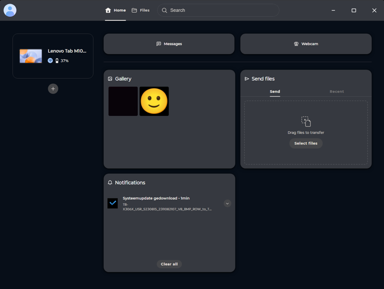

<nav>
  <a href="{{ site.baseurl }}/index.html">Sprint 1</a> | 
  <a href="{{ site.baseurl }}/sprint2.html">Sprint 2</a> |
  <a href="{{ site.baseurl }}/sprint3.html">Sprint 3</a> |
  <a href="{{ site.baseurl }}/sprint4.html">Sprint 4</a> |
  <a href="{{ site.baseurl }}/floor.html">FLOOR</a> |
</nav>
  

# Sprint 3
_25/11/2026_

Deze sprint lag mijn focus wederom vooral bij het design en het regelen van apparaten, onderdelen en bouwmateriaal wat wij nodig hebben voor ons project.

## Stap 1: Hoe krijgen we het dashboard werkend op de tablet?

Mijn team wilde graag dat het dashboard op de tablet draait en dat de microfoon, camera en koptelefoon daar allemaal aan verbonden worden. Ik heb met hun besproken dat dit mij niet niet verstandig leek; de tablet is al vier jaar oud en wij hebben laptops die dit veel beter kunnen processen. Daarbij kan de microfoon niet aangesloten worden op de tablet, omdat dat voor problemen zorgt met de behuizing. Tenslotte hebben wij al genoeg te doen en leek het mij veel te veel werk voor onze enige embedded student.
Voordat ik dit met hun besproken had, had ik een manier gevonden om de tablet als tweede scherm te gebruiken. Het is een Lenovo tablet en via Lenovo is er een app die Smart Connect heet. Met deze app kan je de tablet verbinden met een laptop en het dan als tweede scherm gebruiken. Nadat ik de problemen had aangegeven en deze app met mijn team had besproken, waren zij het eens dat dit een goede oplossing zou zijn.
Na de bespreking wilde ik de app thuis even uitproberen om te kijken of het ook echt werkt.

 

  
  

 

## Eindresultaat & wat ik heb geleerd

## De volgende sprint

## Feedback
